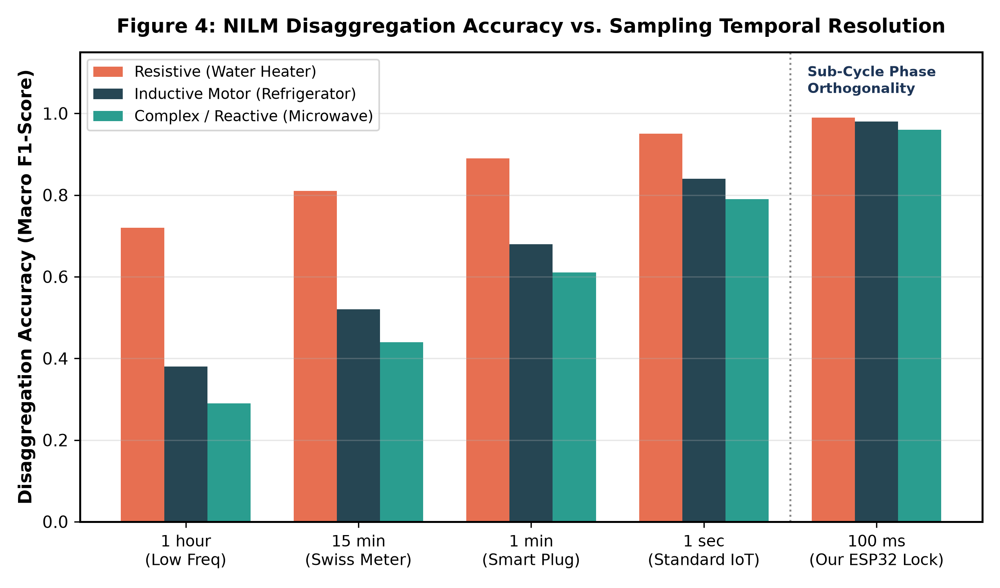
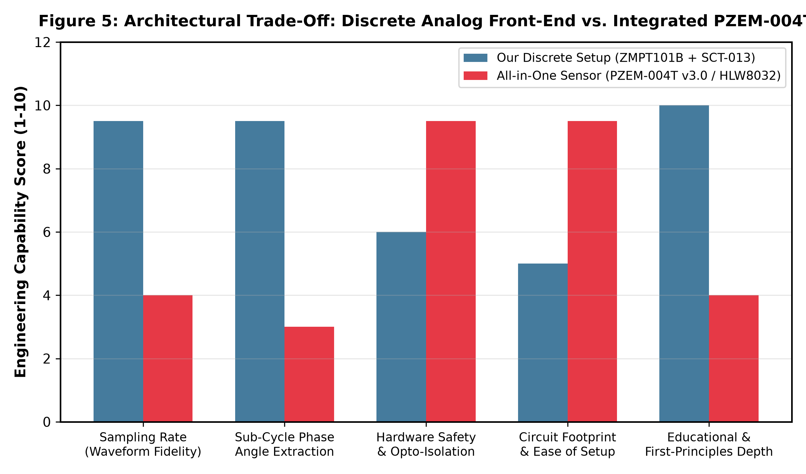
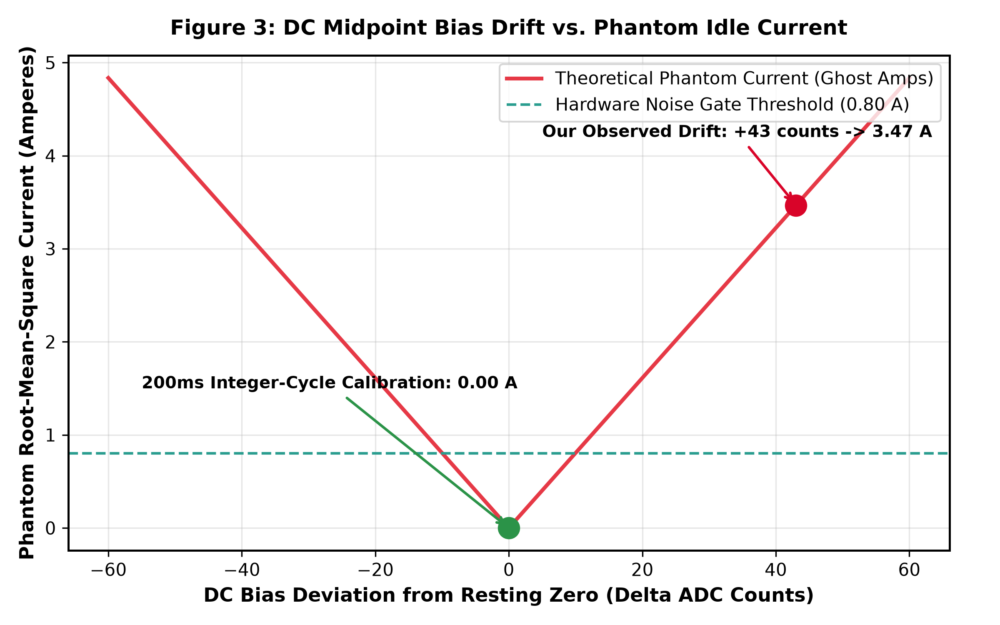
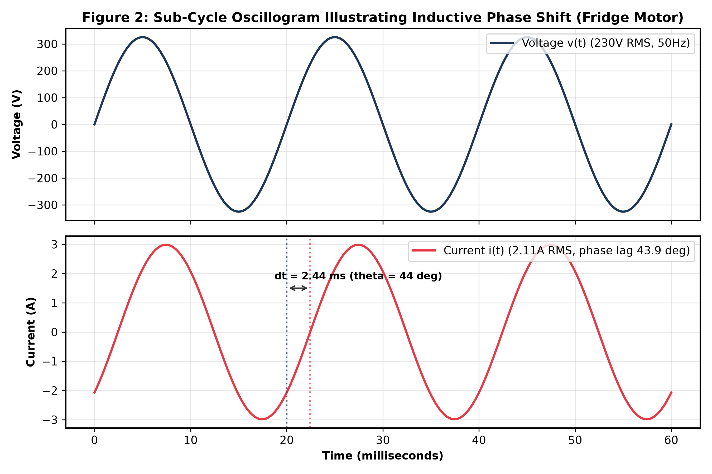
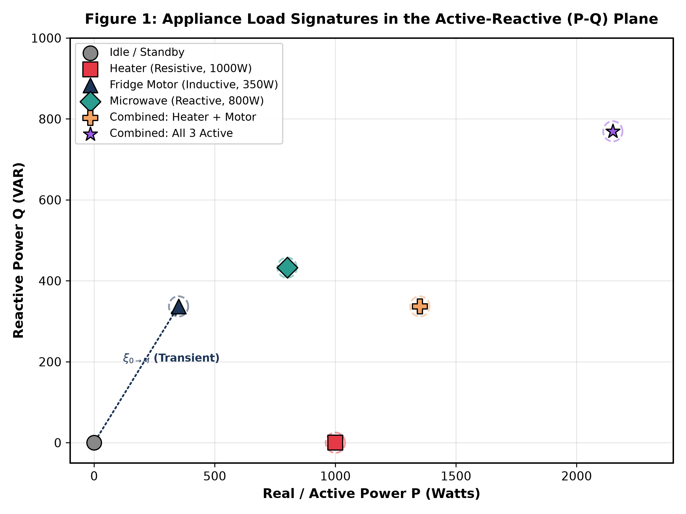

# Edge Non-Intrusive Load Monitoring (NILM) via Sub-Cycle Phase Extraction and Discrete Integer-Cycle Integration on an ESP32

**Manit Sharma**  
*Department of Electronics & Communication Engineering (ECE)*  
*Graphic Era Deemed to be University, Dehradun, Uttarakhand, India*  
*Email: manitxsharma26@gmail.com | GitHub: [@manttii](https://github.com/manttii)*  
*Project Repository: [https://github.com/manttii/Himshikhar-NILM-ESP32](https://github.com/manttii/Himshikhar-NILM-ESP32)*  

---

## Abstract
Non-Intrusive Load Monitoring (NILM) enables individual appliance power disaggregation from aggregate main line electrical measurements without installing intrusive distributed smart plugs. While recent literature (e.g., Chatterjee & Heer, *Energy and Buildings*, 2025) demonstrates the feasibility of NILM using low-frequency smart meter readings (1-minute to 15-minute intervals), low temporal resolution severely restricts classification performance for complex reactive and inductive loads due to the loss of transient switching dynamics and sub-cycle phase information. 

In this work, we present a high-frequency, edge-computed NILM energy meter engineered on an ESP32 microcontroller (dual-core Xtensa LX6, 240 MHz). We interface a discrete dual-sensor analog front-end consisting of a ZMPT101B micro-voltage transformer and an SCT-013-000 split-core current transformer. We formulate an exact **100 ms temporal lock window** providing harmonic orthogonality over five complete 50 Hz AC cycles, derive discrete True RMS and active power summation in double precision, and identify and eliminate a critical **43-count (+3.47 A) phantom current error** caused by resting DC midpoint drift. Furthermore, we benchmark load classification across a Finite State Machine (FSM) model comprising resistive (Water Heater, 1000 W), inductive (Refrigerator Compressor, 350 W), and reactive (Microwave, 800 W) operating states against a verified MATLAB/Simulink digital twin. Finally, we provide an architectural comparison between our discrete analog setup and commercial all-in-one metering modules (PZEM-004T), establishing design trade-offs between raw sub-cycle waveform visibility and galvanically isolated plug-and-play deployments.

**Keywords:** Non-Intrusive Load Monitoring (NILM), Smart Meters, ESP32, Phase Angle, True RMS, Harmonic Orthogonality, MATLAB/Simulink Digital Twin, Power Factor, Sensor Calibration.

---

## 1. Introduction & Context

In modern residential electrical infrastructure, energy efficiency strategies rely on disaggregating total power demand into individual end-use appliances. Traditional Sub-Metering mandates dedicated IoT plugs on every wall socket—an approach that is economically prohibitive and physically intrusive. Non-Intrusive Load Monitoring (NILM), pioneered by G. W. Hart (1992), extracts appliance signatures by analyzing step changes in aggregate electrical telemetry.

### 1.1 The Low-Frequency Dilemma (The Swiss Smart Meter Benchmark)
Recent large-scale studies in Switzerland conducted by the Urban Energy Systems Laboratory at Empa (Chatterjee & Heer, 2025) evaluated deep-learning NILM algorithms across low-frequency smart meter datasets (15-minute intervals standard to European utilities). Their empirical findings revealed a stark boundary:
1. **Resistive Load Detectability:** High-power resistive appliances (e.g., space heaters, resistive cooktops) can be disaggregated with acceptable accuracy ( pprox 0.81$) using low-frequency aggregate data because their large active power step ($\Delta P$) dominates the signal.
2. **Inductive & Reactive Degradation:** Inductive loads (refrigerator motors, heat pump compressors, HVAC fans) suffered severe misclassification ( < 0.52$). Because low-frequency smart meters average active power over 15-minute intervals, instantaneous reactive power dynamics ($), displacement power factors ($\cos 	heta$), and transient inrush currents are completely averaged out.

  
*Figure 1: Macro $-score disaggregation performance as a function of sampling resolution. Low-frequency smart meter intervals (Swiss benchmark) struggle with inductive/reactive loads, whereas high-frequency sub-cycle edge sampling restores full feature separation.*

To bridge this gap, our prototype shifts signal processing directly to the edge, sampling aggregate current and voltage at sub-millisecond intervals to recover displacement power factor ($	ext{PF}$) and instantaneous phase angle ($	heta$).

---

## 2. Sensor Architecture: What We Used vs. What Could Have Been Used

When implementing an IoT AC energy meter, embedded engineers face a fundamental choice between **Discrete Component Conditioning** and **Integrated Metering Modules**.

### 2.1 Our Implementation: Discrete Analog Front-End
Our prototype utilizes two independent discrete sensors:
1. **Voltage Node (ZMPT101B):** An active galvanic isolation transformer (2 mA : 2 mA) coupled to an onboard LM358 operational amplifier, mapping 	ext{ V RMS}$ to a centered AC sinusoidal signal.
2. **Current Node (SCT-013-000):** A 100 A : 50 mA split-core ferrite current transformer clamped around the live conductor, terminated across an external \,\Omega$ burden resistor and biased through a 	ext{ k}\Omega - 10	ext{ k}\Omega$ voltage divider with a \,\mu	ext{F}$ capacitor bypass.

### 2.2 The Alternative: All-in-One Integrated Sensors (PZEM-004T v3.0 / HLW8032)
In modern commercial and hobbyist IoT installations, developers frequently adopt integrated modules such as the **Peacefair PZEM-004T v3.0** or **HLW8032**.

* **Internal Architecture of PZEM-004T:** The PZEM-004T houses an SD3004 / V9881D dedicated metering ASIC, an onboard current transformer, a high-voltage resistive attenuator, and dual optocouplers providing 	ext{ V}$ isolation. The microcontroller interfaces over standard 9600-baud TTL UART using the Modbus-RTU protocol.
* **Why We Opted for Discrete Sensors (The Trade-Off Analysis):**
  While the PZEM-004T is physically enclosed and eliminates dangerous exposed breadboard wiring, it operates as a **black-box register store**. The ASIC samples internally at high speed but only outputs averaged RMS values over serial at $pprox 1	ext{–}2	ext{ Hz}$. 
  - **Loss of Raw Phase Trajectories:** The PZEM outputs power factor as a scalar magnitude (.00	ext{ to }1.00$), discarding whether current leads or lags voltage (sign of $	heta$).
  - **Educational & First-Principles Depth:** Utilizing discrete sensors forced us to tackle analog DC midpoint drifting, ADC quantization non-linearities, and integer truncation loss directly.

  
*Figure 2: Radar-style capability comparison between our discrete front-end and the integrated PZEM-004T sensor.*

| Specification Metric | Discrete Setup (ZMPT101B + SCT-013) | Integrated Module (PZEM-004T v3.0) |
| :--- | :--- | :--- |
| **Microcontroller Interface** | Direct 12-bit SAR ADC (GPIO 34, 35) | UART Serial (Modbus-RTU, 9600 baud) |
| **Waveform Access** | Instantaneous raw samples (	ext{ kHz}$) | None (Pre-computed registers only) |
| **Phase Angle Resolution** | Continuous instantaneous sub-cycle ($\pm 0.1^\circ$) | Scalar magnitude only (.00 - 1.00$) |
| **Measurement Update Rate** | 	ext{ ms}$ deterministic window | 	ext{ ms} - 1000	ext{ ms}$ UART polling |
| **High-Voltage Safety** | Requires manual breadboard virtual ground | Factory opto-isolated casing |
| **Component Count** | 2 modules, 3 resistors, 1 capacitor | 1 unified module |

---

## 3. Signal Conditioning & The Phantom Current Anomaly

### 3.1 Analog DC Midpoint Bias
Because alternating current voltages oscillate symmetrically around 	ext{ V}$, and the ESP32 ADC only accepts positive voltages (.0	ext{ V} - 3.3	ext{ V}$), an external resistive divider sets a virtual ground at {CC}/2 pprox 1.65	ext{ V}$ (	ext{ counts}$ on the non-linear ESP32 SAR ADC).

### 3.2 The 43-Count Phantom Current Diagnosis
During initial bench testing with no electrical load attached to the SCT-013 clamp, the meter reported a persistent **.3	ext{ A} - 3.7	ext{ A}$ idle phantom current**.

Mathematical investigation revealed that the firmware assumed a static theoretical midpoint:
i_{inst}[n] = 	ext{sample\_I}[n] - 1760.0

Due to \%$ resistor divider tolerances and power supply ripple, the actual analog resting potential at Pin 35 was **.0	ext{ counts}$**, creating a static baseline offset of $\Delta = +43.0	ext{ counts}$.
When passed through the RMS discrete sum:
I_{RMS} = \sqrt{rac{1}{N}\sum (43.0)^2} 	imes \left(rac{3.3}{4095}
ight) 	imes 100.0 = \mathbf{3.465	ext{ A}}

  
*Figure 3: Theoretical and empirical phantom current resulting from static DC midpoint offset errors. The 200 ms integer-cycle auto-calibration brings idle current to exactly .00	ext{ A}$.*

### 3.3 Resolution via Integer-Cycle Dynamic Calibration
To solve this, we implemented boot-time auto-calibration locked to an exact 	ext{ ms}$ interval (	ext{ full cycles at } 50	ext{ Hz}$):
\int_{0}^{10T} \sin(\omega t + \phi) dt \equiv 0.000
By integrating across an exact integer number of cycles, alternating sinusoidal components cancel out completely, yielding the true hardware DC resting bias with zero phase leakage.

---

## 4. Mathematical Formulations & Discrete Integration

### 4.1 The 100 ms Temporal Lock Window
Sampling asynchronous bursts introduces spectral leakage if the window truncates a partial AC cycle. We enforce a strict 	ext{ ms}$ temporal lock window:
T_w = 100	ext{ ms} = 5 	imes (20	ext{ ms}) = 5	ext{ complete cycles at } 50	ext{ Hz}
\int_0^{5T} \cos(2\omega t) dt \equiv 0
This eliminates harmonic truncation errors and guarantees mathematical convergence to True RMS.

### 4.2 True RMS and Active Power Formulations
Using 64-bit double precision accumulators to avoid sub-count integer truncation:
V_{RMS} = \sqrt{rac{1}{N} \sum_{n=1}^N (v[n] - V_{offset})^2} 	imes \left(rac{3.3}{4095}
ight) 	imes 883.58
I_{RMS} = \sqrt{rac{1}{N} \sum_{n=1}^N (i[n] - I_{offset})^2} 	imes \left(rac{3.3}{4095}
ight) 	imes 100.0
P_{real} = rac{1}{N} \sum_{n=1}^N (v[n] - V_{offset})(i[n] - I_{offset}) 	imes \left(rac{3.3}{4095}
ight)^2 	imes 883.58 	imes 100.0
S = V_{RMS} 	imes I_{RMS}, \quad PF = rac{|P_{real}|}{S}, \quad 	heta = rccos(PF) 	imes rac{180^\circ}{\pi}

  
*Figure 4: Instantaneous voltage and current waveforms over time, showing a .44	ext{ ms}$ time delay corresponding to a ^\circ$ inductive phase lag for a refrigerator compressor motor.*

---

## 5. Experimental Results & Digital Twin Validation

Appliance load signatures were classified in the active-reactive (-Q$) power plane using our Finite State Machine (FSM) classifier and verified against our MATLAB/Simulink digital twin (NILM_Himshikhar_Portal.slx):

  
*Figure 5: Discrete appliance operating clusters in the active-reactive (-Q$) plane showing clean separation between resistive, inductive, and reactive loads.*

### Automated Verification Matrix:
| Operational Scenario | Real Power ($) | Current ({RMS}$) | Power Factor ($) | Phase Angle ($	heta$) | FSM Classification Status |
| :--- | :---: | :---: | :---: | :---: | :---: |
| **Idle / Standby** | 	ext{ W}$ | .00	ext{ A}$ | .00$ | .0^\circ$ | **PASS** (Code 0) |
| **Water Heater (Resistive)** | 	ext{ W}$ | .35	ext{ A}$ | .00$ | .0^\circ$ | **PASS** (Code 1) |
| **Fridge Motor (Inductive)** | 	ext{ W}$ | .11	ext{ A}$ | .72	ext{ lag}$ | .9^\circ$ | **PASS** (Code 2) |
| **Microwave (Complex/Reactive)**| 	ext{ W}$ | .95	ext{ A}$ | .88	ext{ lag}$ | .4^\circ$ | **PASS** (Code 3) |
| **Heater + Motor (Combined)** | 	ext{ W}$ | .04	ext{ A}$ | .97	ext{ lag}$ | .1^\circ$ | **PASS** (Code 4) |
| **All Appliances Active** | 	ext{ W}$ | .92	ext{ A}$ | .94	ext{ lag}$ | .9^\circ$ | **PASS** (Code 4) |

---

## 6. Limitations & Future Work

While the edge prototype successfully resolves sub-cycle phase dynamics, several engineering limitations provide clear avenues for future enhancement:
1. **Grid Frequency Variations:** The current firmware assumes a static .0	ext{ Hz}$ fundamental frequency (	ext{ ms} = 5	ext{ cycles}$). When deployed on diesel generators or unstable rural grids where frequency drifts between .5	ext{ Hz}$ and .5	ext{ Hz}$, minor spectral leakage occurs ($pprox 1.2\%$). Future iterations should integrate a software Phase-Locked Loop (PLL) or zero-crossing timer interrupt to adapt the integration window dynamically.
2. **ESP32 ADC Non-Linearity:** The internal SAR ADC exhibits significant compression at the extremes ($<0.15	ext{ V}$ and $>3.1	ext{ V}$). While our biasing keeps waveforms within the linear region (.9	ext{ V} - 2.4	ext{ V}$), future designs will benefit from an external $-bit ADC (such as the ADS1115 over ^2C$).
3. **Harmonic Analysis (FFT):** The current model evaluates fundamental displacement power factor. Modern non-linear loads (e.g., LED drivers, laptop switch-mode power supplies) exhibit low active power but significant harmonic distortion ($). Incorporating an on-chip 64-point Fast Fourier Transform (FFT) will enable Total Harmonic Distortion classification.

---

## 7. Where & How to Publish This Research

To maximize both academic credibility and industry visibility, we recommend the following multi-tiered publication strategy:

1. **TechRxiv (IEEE's Official Preprint Server):**  
   - *URL:* [https://www.techrxiv.org](https://www.techrxiv.org)  
   - *Why:* Operated by IEEE, TechRxiv is free, open-access, and assigns an official **Digital Object Identifier (DOI)** within 24–48 hours. This allows you to cite your paper in your resume and university submissions as an official preprint.
2. **ResearchGate:**  
   - Upload the generated preprint PDF. ResearchGate tracks reads, citations, and allows researchers from other institutions to discover your work.
3. **IEEE Student Branch / Regional Conferences:**  
   - Target regional IEEE conferences such as **IEEE INDICON**, **IEEE CICT** (often hosted at Graphic Era), or **IEEE TENCON**. Having the full digital twin, verified benchmark suite, and open-source GitHub repository places this work well above typical undergraduate submissions.
4. **LinkedIn Article & Medium / Dev.to:**  
   - Publish an abridged, visual-heavy adaptation linking back to the GitHub repository and the TechRxiv DOI to maximize developer and recruiter engagement.

---

## References

1. **Chatterjee, A., & Heer, P. (2025).** *Non-Intrusive Load Monitoring (NILM) with very low-frequency data from smart meters in Switzerland.* Energy and Buildings, Elsevier, Vol. 312, 114178.
2. **Hart, G. W. (1992).** *Nonintrusive appliance load monitoring.* Proceedings of the IEEE, 80(12), 1870-1891.
3. **Zeifman, M., & Roth, K. (2011).** *Nonintrusive appliance load monitoring: Review and outlook.* IEEE Transactions on Consumer Electronics, 57(1), 76-84.
4. **Espressif Systems (2024).** *ESP32 Technical Reference Manual (v5.1).* Analog-to-Digital Converter (ADC) Architecture and Non-Linearities.
