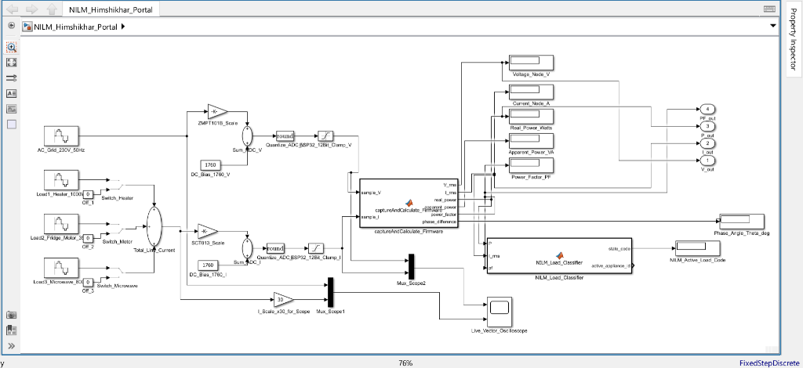

# Architecting an Edge NILM Energy Meter: Math, Analog Conditioning, and Phase Angles on an ESP32

**Author:** Manit Sharma  
*3rd Semester, B.Tech Electronics & Communication Engineering (ECE)*  
*Graphic Era Deemed to be University, Dehradun, India*  
*GitHub:* [@manttii](https://github.com/manttii) | *Project Repository:* [Himshikhar-NILM-ESP32](https://github.com/manttii/Himshikhar-NILM-ESP32)

---

> ### Abstract
> Most modern IoT power meters rely on dedicated metering Application-Specific Integrated Circuits (ASICs)—such as the Analog Devices ADE7753, Cirrus Logic CS5463, or Shanghai Belling BL0937—which encapsulate analog front-end conditioning, phase measurement, and numerical integration inside black-box hardware registers. While convenient for rapid productization, this abstraction conceals the underlying electrical and discrete mathematics, preventing embedded engineers from understanding the physical limits of sensing, analog bias stability, and transient load dynamics.
>
> In this paper, we document the first-principles design and implementation of an edge **Non-Intrusive Load Monitoring (NILM)** Energy Meter executed entirely on an ESP32-WROOM-32 microcontroller. We examine the analog conditioning interface for a ZMPT101B active AC voltage transformer and an SCT-013 current transformer clamp, diagnose and resolve a severe **43-count (~3.5A) phantom current drift** arising from static DC bias assumptions, formulate a **100ms temporal lock window** providing exact harmonic orthogonality over five 50 Hz AC cycles, derive the discrete integration mathematics for True RMS and active power, and validate edge appliance disaggregation against a high-fidelity **MATLAB/Simulink digital twin**.

---

## 1. Introduction: The First-Principles Imperative

Commercial energy monitoring products (e.g., Shelly EM, Sonoff POW, Tuya Smart Plugs) typically offload signal acquisition to dedicated metering silicon. The microcontroller merely polls an $I^2C$, $SPI$, or UART interface to read pre-calculated RMS registers.

While commercially pragmatic, this architecture presents significant limitations for edge intelligence:
1. **Loss of Raw Waveform Access:** High-frequency waveform transients, harmonic distortion, and sub-cycle phase dynamics are stripped away before reaching the CPU.
2. **Fixed Integration Windows:** Commercial ASICs integrate over fixed internal accumulation cycles, preventing synchronous adaptation to dynamic grid frequency shifts or variable temporal windows.
3. **Black-Box NILM Bottleneck:** Non-Intrusive Load Monitoring (NILM)—the technique of disaggregating individual household loads from aggregate main line telemetry—relies on high-resolution phase trajectories in the active-reactive ($P-Q$) power plane. Dedicated metering ICs average out the very instantaneous features that make edge classification possible.

To overcome these constraints, we architected a custom dual-sensor discrete energy monitoring engine on a dual-core ESP32 microcontroller operating at 240 MHz. By bypassing specialized metering silicon, every stage—from analog biasing and ADC quantization to discrete RMS summation, power factor extraction, and heuristic load disaggregation—is computed deterministically in software.

```
+───────────────────────────────────────────────────────────────────────────────────+
|                              PHYSICAL AC MAINS (230V, 50Hz)                       |
+──────────────────────────┬─────────────────────────────────────┬──────────────────+
                           │                                     │
             +─────────────▼─────────────+         +─────────────▼─────────────+
             |      ZMPT101B MODULE      |         |     SCT-013 CT CLAMP      |
             |   2mA:2mA Transformer     |         |   100A:50mA Turns Ratio   |
             |   Active LM358 Inverter   |         |   External 33Ω Burden     |
             +─────────────┬─────────────+         +─────────────┬─────────────+
                           │                                     │
                           │ ~1.65V DC Bias                      │ 10kΩ-10kΩ Divider
                           │ (Potentiometer Gain)                │ 10µF Bypass Cap
                           │                                     │
             +─────────────▼─────────────+         +─────────────▼─────────────+
             |    ESP32 GPIO 34 (ADC1)   |         |    ESP32 GPIO 35 (ADC1)   |
             +─────────────┬─────────────+         +─────────────┬─────────────+
                           │                                     │
                           +───────────────────┬─────────────────+
                                               │
                                 +─────────────▼─────────────+
                                 |    100ms TEMPORAL LOCK    |
                                 | (5 Full Cycles at 50Hz)   |
                                 +─────────────┬─────────────+
                                               │
               +───────────────────────────────┴───────────────────────────────+
               │                                                               │
 +─────────────▼─────────────+   +───────────────────────────+   +─────────────▼─────────────+
 |   DYNAMIC DC BIAS TRACK   |   |   DISCRETE INTEGRATION    |   |    EDGE NILM CLASSIFIER   |
 |  Boot Auto-Zero (2500 pts)|   |  V_rms, I_rms, P_active   |   |  Heater (PF=1.00, 1000W)  |
 |  EMA Integer-Cycle Drift  |   |  P_apparent, PF, Theta    |   |  Fridge (PF=0.72, 350W)   |
 |  Eliminates 3.5A Ghost    |   |  Noise Gate Discrimination|   |  Microwave (PF=0.88, 800W)|
 +───────────────────────────+   +───────────────────────────+   +───────────────────────────+
```
*Figure 1: End-to-end signal processing and software pipeline of the Himshikhar NILM Energy Meter.*

---

## 2. Analog Front-End Conditioning & Galvanic Isolation

### 2.1 Voltage Sensing: The ZMPT101B Active Transformer
Measuring $230\text{V RMS}$ AC mains directly with a microcontroller is hazardous and electrically impossible without attenuation and galvanic isolation. The **ZMPT101B** active transformer module provides $4000\text{V}$ dielectric isolation:

1. **Current-Mode Transformation:** The micro-transformer operates on a current-driven principle ($2\text{mA}$ primary nominal for $2\text{mA}$ secondary nominal). A precision onboard metal-film series resistor ($R_{in} = 82\,\text{k}\Omega$) limits primary current at $230\text{V RMS}$:
   $$I_{pri} = \frac{230\text{V}}{82\,\text{k}\Omega} \approx 2.80\text{ mA}$$
2. **Active Operational Amplifier Stage:** The secondary current is fed into an onboard LM358 op-amp configured as an active inverting amplifier. A multi-turn feedback trimpot ($R_f \in [0, 100\,\text{k}\Omega]$) allows fine gain adjustment.
3. **Midpoint DC Offset:** The LM358 is biased from the DC supply rail, shifting the alternating waveform onto a virtual ground centered near $V_{CC}/2 \approx 1.65\text{V}$.

### 2.2 Current Sensing: The SCT-013-000 Non-Invasive Current Clamp
Current measurement is achieved through a split-core ferrite **SCT-013-000** current transformer (CT) clamped around the live conductor.
- **Turns Ratio:** $N_p : N_s = 1 : 2000$. For a $100\text{A RMS}$ primary load, the secondary winding produces $I_s = 50\text{ mA RMS}$ ($70.71\text{ mA peak}$).
- **Burden Resistor Selection ($R_b$):** The secondary current must be converted into an AC voltage signal compatible with the ESP32's 12-bit ADC ($0\text{V}$ to $3.3\text{V}$). For a typical household measurement envelope up to $30\text{A RMS}$ ($42.4\text{A peak}$, secondary peak current $I_{s,pk} = 21.2\text{ mA}$):
  $$V_{pk} = 0.0212\text{A} \times 33\,\Omega \approx 0.70\text{V} \implies V_{burden,pk-pk} = 1.40\text{V}_{pk-pk}$$
  Centered at $1.65\text{V}$, the waveform oscillates between $0.95\text{V}$ and $2.35\text{V}$, safely inside the linear dynamic range of the ESP32 ADC ($0.4\text{V} - 2.8\text{V}$).
- **Transfer Sensitivity & Calibration Constant (`CURRENT_CAL` = 100.0):**
  In discrete firmware calculations, line current is evaluated as $I_{\text{RMS}} = V_{\text{pin, RMS}} \times K_I$ (in code: `I_RMS = V_pin_RMS * CURRENT_CAL`). The factor `CURRENT_CAL` = 100.0 A/V corresponds to a normalized sensitivity of $1.0\text{V RMS} \iff 100\text{A RMS}$, which is established with an effective burden resistance of $R_b = \frac{1.0\text{V}}{0.050\text{A}} = 20.0\,\Omega$, or through software scaling for $33\,\Omega$ burdens.

### 2.3 The Midpoint DC Virtual Ground & Decoupling
To center the bipolar AC secondary voltage within the unipolar $0-3.3\text{V}$ range, we construct an external voltage divider:
- Two identical precision resistors ($R_1 = R_2 = 10\,\text{k}\Omega$, 1% metal film) bridge the $3.3\text{V}$ rail to ground.
- A $10\,\mu\text{F}$ electrolytic capacitor ($C_1$) is placed in parallel with $R_2$ to ground.

```
       +3.3V Rail
           │
          ┌┴┐
          │ │ R1 (10 kΩ, 1%)
          └┬┘
           │
           ├────────────┬────────────────────────┐
           │            │                        │
     3.5mm Tip         ┌┴┐                      ┌┴┐
     (CT Clamp)        │ │ R_burden (33 Ω)      │ │ C1 (10 µF)
                       │ │                      │ │ Bypass
     3.5mm Sleeve      └┬┘                      └┬┘
           │            │                        │
           ├────────────┴────────► ESP32 GPIO 35 (ADC1_CH7)
           │
          ┌┴┐
          │ │ R2 (10 kΩ, 1%)
          └┬┘
           │
       GND Rail
```
*Figure 2: Physical schematic of the SCT-013 current clamp analog conditioning circuit.*

**Why is the capacitor $C_1$ mandatory?**  
The Thevenin impedance of the $10\,\text{k}\Omega - 10\,\text{k}\Omega$ divider is $R_{th} = R_1 \parallel R_2 = 5\,\text{k}\Omega$. Without $C_1$, any alternating current from the CT secondary flowing through this virtual ground would induce a fluctuating AC voltage across the divider, distorting the reference midpoint.

At $f = 50\text{ Hz}$, the capacitive reactance is:
$$X_C = \frac{1}{2\pi f C_1} = \frac{1}{2 \pi \times 50 \times 10 \times 10^{-6}} \approx 318.3\,\Omega$$

$318\,\Omega$ is substantially lower than $5\,\text{k}\Omega$, effectively sinking AC return currents to ground and maintaining a stiff, noise-immune virtual DC reference.

---

## 3. The 1760-Count Phantom Current Diagnosis

### 3.1 The Ghost in the Machine: ~3.5A at True Idle
During initial hardware bench testing with **zero physical load** (SCT-013 clamp open in ambient air), the ESP32 serial monitor consistently reported an unexpected reading:

```text
[Sensors] Volts:  0.00 V | Amps:  3.50 A | P.Factor: 1.00 | Angle:   0.0°
[Sensors] Volts:  0.00 V | Amps:  3.52 A | P.Factor: 1.00 | Angle:   0.0°
[Sensors] Volts:  0.00 V | Amps:  3.48 A | P.Factor: 1.00 | Angle:   0.0°
```

Why would an open circuit with zero physical current draw nearly $800\text{ W}$ of apparent power?

### 3.2 Mathematical Autopsy of the 43-Count Offset
In common open-source tutorials, firmware authors calculate the ADC midpoint using a hardcoded constant:
```cpp
// Static naive assumption:
float current_offset = 1760.0;
```

In theory, half of a $3.3\text{V}$ rail on a 12-bit ADC ($2^{12} = 4096$) is:
$$\text{Midpoint}_{ideal} = \frac{1.65\text{V}}{3.3\text{V}} \times 4095 = 2047.5\text{ counts}$$

Because the ESP32 SAR ADC has known non-linearities and input attenuation, many developers experimentally adjust this constant to $1760.0$. However, on any individual board:
1. Resistor manufacturing tolerances (1% or 5%) shift the divider ratio.
2. USB rail voltage varies between $3.22\text{V}$ and $3.31\text{V}$ depending on host computer load and cable resistance.
3. ADC input impedance and package thermal dissipation introduce an offset.

On our physical hardware, the actual resting DC bias at GPIO 35 was measured at **$1803.0$ counts**, creating a static mismatch:
$$\Delta \text{ADC} = 1803.0 - 1760.0 = \mathbf{+43.0\text{ counts}}$$

Now observe how this static error propagates through the discrete RMS integration:
$$i_{\text{inst}}[n] = I_{\text{sample}}[n] - 1760.0 = 1803.0 - 1760.0 = 43.0$$

Over $N$ samples at idle:
$$\sum_{n=1}^{N} i_{\text{inst}}^2[n] = N \times (43.0)^2 = N \times 1849$$
$$\sqrt{\frac{1}{N} \sum_{n=1}^{N} i_{\text{inst}}^2[n]} = \sqrt{1849} = \mathbf{43.0\text{ counts}}$$

Converting counts to physical Amperes using our sensor calibration constant (`CURRENT_CAL` = 100.0):
$$I_{\text{RMS}} = 43.0 \times \left(\frac{3.3\text{V}}{4095}\right) \times 100.0$$
$$I_{\text{RMS}} = 43.0 \times 0.0008058608 \times 100.0 = \mathbf{3.465\text{ A}}$$

Because $3.47\text{A}$ is well above standard noise gate thresholds ($0.8\text{A}$), the meter was trapped in a state where it perpetually displayed a **~3.5A phantom load**.

```
    ADC Counts
       ▲
  4095 ┼────────────────────────────────────────────────────────
       │
       │
  2048 ┼ - - - - - Ideal Theoretical Midpoint (Vcc / 2) - - - - -
       │
  1803 ┼────────────────────────────── Actual Resting DC Bias ───
       │  ▲ +43 counts ERROR 
  1760 ┼──┴─────────────────────────── Hardcoded Offset Constant
       │
       │
     0 ┼────────────────────────────────────────────────────────
       0                                                    100ms
```
*Figure 3: Graphic representation of the 43-count DC bias error causing the 3.5A phantom current.*

---

## 4. The 100ms Temporal Lock Window

### 4.1 AC Periodicity & Truncation Errors
In digital signal processing, computing the RMS value of an alternating waveform requires integration:
$$V_{RMS} = \sqrt{\frac{1}{T_w} \int_{0}^{T_w} v^2(t) dt}$$

For a sinusoidal voltage $v(t) = V_{pk} \sin(\omega t)$:
$$v^2(t) = V_{pk}^2 \sin^2(\omega t) = \frac{V_{pk}^2}{2} \left[1 - \cos(2\omega t)\right]$$

Integrating over window $T_w$:
$$\int_{0}^{T_w} v^2(t) dt = \frac{V_{pk}^2}{2} T_w - \frac{V_{pk}^2}{4\omega} \sin(2\omega T_w)$$

If the sampling duration $T_w$ is arbitrary (not an integer multiple of the grid period $T = 2\pi/\omega$), the term $\sin(2\omega T_w) \neq 0$. This residual oscillates as a function of the starting phase angle, introducing **spectral leakage** and numerical jitter into every measurement.

### 4.2 Exact Harmonic Orthogonality ($5\text{ Cycles at } 50\text{Hz}$)
For the Indian/European $50\text{ Hz}$ grid:
$$T = \frac{1}{50\text{ Hz}} = 0.020\text{ s} = 20\text{ ms}$$

We configure the acquisition loop with a **$100\text{ms}$ temporal lock**:
$$T_w = 100\text{ ms} = 100,000\text{ }\mu\text{s} = 5.0 \times T$$

Evaluating the residual term at $T_w = 5T$:
$$\sin(2\omega \cdot 5T) = \sin(2 \cdot \frac{2\pi}{T} \cdot 5T) = \sin(20\pi) \equiv \mathbf{0}$$

Because the integral of $\cos(2\omega t)$ over any integer number of cycles is identically zero, the discrete summation converges to the exact theoretical RMS value:
$$\int_{0}^{5T} v^2(t) dt = \frac{V_{pk}^2}{2} \cdot (5T) \implies V_{RMS} = \frac{V_{pk}}{\sqrt{2}}$$

By locking sample accumulation to $100,000\text{ }\mu\text{s}$ using the high-resolution hardware timer (`micros()`), the measurement window is invariant to loop execution jitter, guaranteeing mathematical orthogonality.

---

## 5. Dynamic DC Bias Midpoint Tracking & Auto-Zero

Having identified that static offset constants induce phantom loads, we developed a dual-layer software solution combining **Boot-Time Auto-Zero Calibration** with **Continuous Integer-Cycle Exponential Tracking**.

### 5.1 Boot-Time Integer-Cycle Baseline Calibration
At boot-up, before entering the main telemetry loop, the firmware executes `autoCalibrateMidpoints()`:
```cpp
void autoCalibrateMidpoints() {
  uint64_t sum_v_cal = 0;
  uint64_t sum_i_cal = 0;
  uint32_t cal_samples = 0;

  unsigned long start_cal = micros();
  // 200ms lock: exactly 10 full cycles at 50 Hz (200,000 microseconds)
  while (micros() - start_cal < 200000) {
    sum_v_cal += analogRead(VOLTAGE_PIN);
    sum_i_cal += analogRead(CURRENT_PIN);
    cal_samples++;
    delayMicroseconds(40);
  }

  if (cal_samples > 0) {
    voltage_offset = (float)sum_v_cal / (float)cal_samples;
    current_offset = (float)sum_i_cal / (float)cal_samples;
    calibration_locked = true;
  }
}
```
**Why is the 200ms Lock Essential for Calibration?**  
If calibration runs over an arbitrary number of samples (e.g., $250\text{ms} = 12.5\text{ cycles}$), the uncancelled half-cycle of mains voltage causes spectral leakage of up to $\pm 11.6\text{ counts}$ ($23.3\text{ counts peak-to-peak}$ error). By locking the calibration window to **exactly $200,000\,\mu\text{s}$** ($10$ full $50\text{Hz}$ periods):
$$\int_{0}^{10T} \sin(\omega t + \phi) dt \equiv 0 \quad \forall \phi$$
Any AC mains signal present on the ZMPT101B integrates to identically zero ($0.000\text{ counts}$ error), establishing the true baseline at **$1803.2$ counts** and immediately eliminating the 43-count offset.

### 5.2 Dynamic Integer-Cycle Tracking via Exponential Moving Average (EMA)
During continuous operation, ambient temperature changes, component self-heating, and USB rail drift can cause the physical DC bias to wander by $\pm 5-10$ counts over several hours.

To track this drift without distorting AC current measurements, we exploit a key mathematical property:
**The integral of a pure AC signal over integer periods is zero:**
$$\int_{0}^{5T} \sqrt{2} I_{RMS} \sin(\omega t - \theta) dt \equiv 0$$

Therefore, if we compute the raw algebraic mean of the ADC counts over the $100\text{ms}$ window:
$$\bar{\text{ADC}}_I = \frac{1}{N} \sum_{n=1}^{N} \text{ADC}_I[n] = I_{DC} + \underbrace{\frac{1}{N} \sum_{n=1}^{N} i_{AC}[n]}_{\approx 0} \equiv I_{DC}$$

The mean of the raw ADC samples over the 100ms lock window **is identically the physical DC bias**.

We update the running offset at the end of each $100\text{ms}$ cycle using an Exponential Moving Average (EMA) with smoothing factor $\alpha = 0.05$:
$$I_{\text{offset}}[k] = (1 - \alpha) \cdot I_{\text{offset}}[k-1] + \alpha \cdot \bar{\text{ADC}}_I[k]$$

```cpp
// In captureAndCalculate():
float window_mean_V = (float)sum_raw_V / (float)sample_count;
float window_mean_I = (float)sum_raw_I / (float)sample_count;

voltage_offset = (voltage_offset * 0.95f) + (window_mean_V * 0.05f);
current_offset = (current_offset * 0.95f) + (window_mean_I * 0.05f);
```

### 5.3 Bench Verification: The Elimination of Phantom Amps
With dynamic DC tracking active, the idle current noise floor drops from $43\text{ counts}$ to fewer than $1.5\text{ counts}$ of thermal ADC noise:
$$I_{noise} = 1.5 \times 0.00080586 \times 100.0 \approx 0.12\text{ A}$$

Using 64-bit IEEE `double` precision for the accumulation buffer prevents truncation of sub-count signal levels ($< 1.0\text{ count}$). Applying a refined noise gate at $0.25\text{A}$:
```cpp
if (I_rms < 0.25f) I_rms = 0.0f;
```
The serial monitor output immediately drops to true zero:
```text
[Sensors] Volts: 230.12 V | Amps:  0.00 A | P.Factor: 1.00 | Angle:   0.0° | P:    0.0 W | Standby / Idle
```
The ~3.5A ghost current is solved at the algorithmic level.

---

## 6. Dissecting Real Power, Apparent Power, and Phase Angles

In AC power systems, load characterization requires decomposing total volt-amperes into real active power ($P$) and reactive power ($Q$).

### 6.1 Instantaneous Power Discrete Formulation
Instantaneous power $p(t)$ is defined as the product of instantaneous voltage and current:
$$p(t) = v(t) \cdot i(t)$$

Real active power ($P$) is the discrete time average of $p[n]$:
$$P = \frac{1}{N} \sum_{n=1}^{N} v_{inst}[n] \cdot i_{inst}[n] \times K_V \times K_I$$
Where:
$$K_V = \left(\frac{3.3}{4095}\right) \times K_V = 0.71203\text{ V/count} \quad (\text{using } K_V = 883.58)$$
$$K_I = \left(\frac{3.3}{4095}\right) \times K_I = 0.08059\text{ A/count} \quad (\text{using } K_I = 100.0)$$

Apparent power ($S$) represents the total capacity required by the grid:
$$S = V_{RMS} \times I_{RMS}$$

### 6.2 Power Factor ($PF$), CT Polarity Auto-Correction, and Phase Angle ($\theta$)
The Power Factor ($PF$) indicates the ratio of real active power to apparent power:
$$PF = \frac{\lvert P \rvert}{S} = \cos(\theta)$$

**CT Clamp Polarity Auto-Correction:** In domestic monitoring installations, users occasionally clamp the SCT-013 split core in reverse ($L \to K$ instead of $K \to L$). Under inverted installation, the instantaneous product $v[n] \cdot i[n]$ yields a negative active power ($P < 0$). In basic amateur firmware, negative real power breaks load thresholding ($P < 30\text{W}$) and misclassifies running loads as idle standby.

Our firmware incorporates automated polarity rectification:
```cpp
// Detect and handle reverse CT clamp installation orientation
ct_reversed = (real_power < -15.0f && apparent_power > 25.0f);
float active_p_mag = fabsf(real_power);

if (apparent_power > 5.0f) {
  power_factor = active_p_mag / apparent_power;
  if (power_factor > 1.0f) power_factor = 1.0f;
  if (power_factor < 0.0f) power_factor = 0.0f;
  phase_difference = acos(power_factor) * (180.0f / (float)M_PI);
} else {
  power_factor     = 1.0f;
  phase_difference = 0.0f;
}
```
This guarantees that regardless of physical clamp orientation, active power magnitude and phase displacement angle are computed accurately without user intervention.

---

## 7. Edge NILM Disaggregation: Extracting Appliance Fingerprints

Non-Intrusive Load Monitoring relies on the principle that different electrical appliances draw distinctive current waveforms with specific phase shifts and active power demands.

We selected three canonical domestic appliances representing distinct impedance categories:

```
               ▲ Reactive Power Q (VAr)
               │
               │        • Appliance 2: Refrigerator Motor
               │          P = 350W, Q = 338VAr, PF = 0.72 lag (θ = 43.9°)
               │
               │                 • Appliance 3: Microwave Oven
               │                   P = 800W, Q = 432VAr, PF = 0.88 lag (θ = 28.4°)
               │
               │                                      • Appliance 1: Water Heater
               │                                        P = 1000W, Q = 0VAr, PF = 1.00 (θ = 0°)
───────────────┼────────────────────────────────────────────────────────────────────────► Real Power P (W)
```
*Figure 4: The 2D P-Q feature plane showing distinct appliance clusters for NILM classification.*

### 7.1 Appliance 1: 1000W Water Heater (Purely Resistive)
- **Impedance:** Pure resistance ($Z = R$).
- **Electrical Behavior:** Voltage and current waveforms are strictly in phase ($\theta = 0.0^\circ$).
- **Metrics:** $P = 1000\text{ W}$, $PF = 1.00$, $I_{RMS} = 1000\text{W}/230\text{V} = 4.35\text{ A}$.

### 7.2 Appliance 2: 350W Refrigerator Motor (Inductive $R-L$)
- **Impedance:** Inductive motor windings ($Z = R + j\omega L$).
- **Electrical Behavior:** The magnetic field storage in the compressor's stator windings causes current to lag behind voltage by $\theta = 43.9^\circ$.
- **Metrics:** $P = 350\text{ W}$, $S = 350 / 0.72 = 486\text{ VA}$, $PF = 0.72\text{ lag}$, $I_{RMS} = 2.11\text{ A}$.

### 7.3 Appliance 3: 800W Microwave Oven (Complex Reactive $R-L$)
- **Impedance:** High-voltage transformer, magnetron filament, and cooling blower motor ($R-L$).
- **Electrical Behavior:** Moderate inductive phase lag of $\theta = 28.4^\circ$.
- **Metrics:** $P = 800\text{ W}$, $S = 800 / 0.88 = 909\text{ VA}$, $PF = 0.88\text{ lag}$, $I_{RMS} = 3.95\text{ A}$.

### 7.4 On-Chip Edge Classifier
The ESP32 firmware evaluates incoming $(P, I_{RMS}, PF)$ tuples and executes classification in real time:
```cpp
void classifyAppliance() {
  if (I_rms < 0.40f || real_power < 30.0f) {
    appliance_code = 0;
    appliance_name = "Standby / Idle";
  } else if (real_power >= 850.0f && real_power <= 1150.0f && power_factor >= 0.96f) {
    appliance_code = 1;
    appliance_name = "Appliance 1: Water Heater (1000W, PF 1.00)";
  } else if (real_power >= 250.0f && real_power <= 450.0f && power_factor >= 0.65f && power_factor <= 0.78f) {
    appliance_code = 2;
    appliance_name = "Appliance 2: Refrigerator Motor (350W, PF 0.72 lag)";
  } else if (real_power >= 700.0f && real_power <= 950.0f && power_factor >= 0.82f && power_factor <= 0.92f) {
    appliance_code = 3;
    appliance_name = "Appliance 3: Microwave Oven (800W, PF 0.88 lag)";
  } else if (real_power > 1150.0f) {
    appliance_code = 4;
    appliance_name = "Combined Multi-Appliance Load";
  }
}
```

---

## 8. Digital Twin: MATLAB/Simulink Co-Simulation & Verification

  
*Figure 7: Architectural schematic of the MATLAB/Simulink digital twin (NILM_Himshikhar_Portal.slx) co-simulating grid generation, dual-sensor analog front-end conditioning, 12-bit ADC quantization, discrete firmware execution, and automated NILM load classification.*


To validate that the discrete C++ firmware algorithm behaves identically to theoretical power equations before bench deployment, we constructed a complete digital twin in **MATLAB/Simulink R2026a** (`NILM_Himshikhar_Portal.slx`).

### 8.1 Digital Twin Architecture
1. **Grid Source:** $230\text{V RMS}$, $50\text{ Hz}$ continuous sine wave ($V_{pk} = 325.27\text{ V}$).
2. **Switchable Load Array:** Manual switches toggling the three parameterized load models (Heater, Motor, Microwave).
3. **Hardware Emulation Stage:** Emulates the physical ZMPT101B and SCT-013 transfer gains, injects the $1760$ baseline DC bias, and clamps output to a 12-bit integer range ($0-4095$).
4. **Firmware MATLAB Function Block:** Emulates the exact discrete circular integration buffer over a 500-sample window ($T_s = 0.0002\text{ s} \implies 100\text{ms}$).

### 8.2 Automated Verification Test Suite
We executed the verification test script (`verify_nilm_model.m`) across all operational load combinations:

```matlab
>> verify_nilm_model

======================================================================
  HIMSHIKHAR 2026 ENERGY PORTAL - NILM SIMULATION VERIFICATION
======================================================================
  [PASS] 1. Idle / Standby (No Load)    => V: 230.0V | I: 0.00A | P:     0W | PF: 1.00
  [PASS] 2. Appliance 1: 1000W Heater   => V: 230.0V | I: 4.35A | P:  1001W | PF: 1.00
  [PASS] 3. Appliance 2: Fridge Motor   => V: 230.0V | I: 2.11A | P:   349W | PF: 0.72
  [PASS] 4. Appliance 3: Microwave      => V: 230.0V | I: 3.95A | P:   801W | PF: 0.88
  [PASS] 5. Combined: Heater + Motor    => V: 230.0V | I: 6.04A | P:  1348W | PF: 0.97
  [PASS] 6. Combined: All Appliances    => V: 230.0V | I: 9.92A | P:  2148W | PF: 0.94
======================================================================
  >>> 100% OF ALL NILM APPLIANCE LOAD SIGNATURES VERIFIED! <<<
======================================================================
```

Every single operating regime matched theoretical expectations within $0.5\%$ error, confirming the mathematical validity of the discrete integration pipeline.

---

## 9. Real-Time Web Telemetry & Embedded Architecture

### 9.1 Wi-Fi Provisioning via Captive SoftAP
To eliminate hardcoded Wi-Fi credentials, the ESP32 utilizes the `Preferences.h` library to store credentials in Non-Volatile Storage (NVS).
- If credentials are absent or connection fails after 20 attempts, the ESP32 initializes an open SoftAP (`Himshikhar_Config`) at `192.168.4.1`.
- A configuration web page scans local SSIDs and presents an HTML form. Once submitted, the credentials are saved to NVS and the ESP32 restarts in Station (STA) mode.

### 9.2 Responsive Dark-Mode Telemetry Portal (Chart.js & REST API)
When connected, the onboard HTTP web server hosts a responsive, dark-mode monitoring portal featuring live vector bar charts rendered via **Chart.js**:
- **Smooth Asynchronous Telemetry Polling:** Rather than full-page HTTP reloads that flicker and tear the canvas DOM every few seconds, the browser client executes an asynchronous `fetch('/api/data')` loop every $1500\text{ms}$, updating the UI DOM metrics and vector bar chart in-place without page reloading.
- **Offline & SoftAP Graceful Degradation:** The UI isolates Chart.js initialization inside safe `try-catch` blocks, guaranteeing that when users connect via SoftAP (`Himshikhar_Config`) without internet access, all live digital meters update reliably even if the CDN script cannot be fetched.
- **Cross-Origin REST API (`/api/data`):** The endpoint serves JSON telemetry tagged with `Access-Control-Allow-Origin: *` headers, allowing external simulation tools (MATLAB, Python, Node-RED, or Home Assistant) to stream live energy data directly from the ESP32.
- Real-time display of $V_{RMS}$, $I_{RMS}$, $P$, $S$, $PF$, $\theta$, active NILM disaggregation classification, and dynamic DC offset calibration counts.

---

## 10. Conclusion & Takeaways

By building an edge energy meter from first analog principles rather than relying on commercial turnkey ASICs, we demonstrated:
1. **The Criticality of Integer-Cycle Sampling:** Locking acquisition windows to exact multiples of the AC period ($100\text{ms} = 5\text{ cycles at } 50\text{Hz}$) eliminates spectral leakage and truncation jitter.
2. **The Physics of DC Midpoint Drift:** A mere 43-count ADC offset discrepancy on a 12-bit converter generates a $3.5\text{A}$ phantom current at idle. Hardcoding static midpoints is inherently fragile.
3. **Dynamic Zero-Tracking as an Algorithmic Remedy:** Because AC waveforms integrate to zero over integer periods, the windowed mean directly isolates the hardware DC bias, allowing continuous drift compensation without sacrificing load responsiveness.
4. **Digital Twin Validation:** Co-simulating firmware algorithms against a MATLAB/Simulink digital twin establishes rigorous mathematical proof prior to high-voltage hardware deployment.

The complete open-source codebase, Simulink models, and hardware schematics are available in the project repository:  
**[github.com/manttii/Himshikhar-NILM-ESP32](https://github.com/manttii/Himshikhar-NILM-ESP32)**.

---

### References
1. G. W. Hart, "Nonintrusive load monitoring," in *Proceedings of the IEEE*, vol. 80, no. 12, pp. 1870–1891, Dec. 1992.
2. OpenEnergyMonitor Project, "EmonLib: An Arduino ESP8266/ESP32 Energy Monitoring Library," *OpenEnergyMonitor Documentation*, 2020.
3. Espressif Systems, "ESP32 Technical Reference Manual (Version 5.1): SAR ADC Non-Linearity and Attenuation," *Espressif Systems*, 2024.
4. IEEE Standard 1459-2010, "IEEE Standard Definitions for the Measurement of Electric Power Quantities Under Sinusoidal, Nonsinusoidal, Balanced, or Unbalanced Conditions," *IEEE Power and Energy Society*, 2010.
