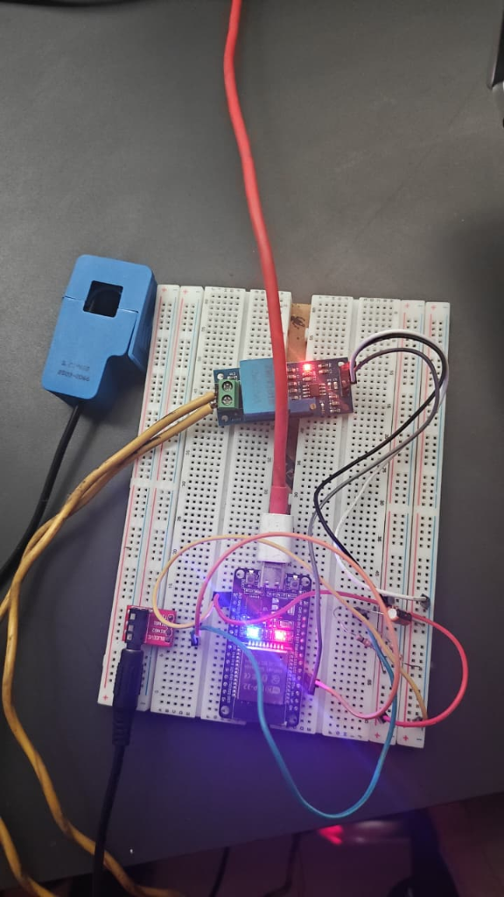

# Hardware Architecture, Pinout & Circuit Schematic

This document provides the complete hardware wiring specifications, circuit theory, component bill of materials (BOM), and physical breadboard implementation for the **Himshikhar 2026 ESP32 NILM Energy Meter**.

---

## 1. Physical Breadboard Setup



*Figure 1: Physical breadboard implementation featuring the ESP32 DevKit, ZMPT101B AC voltage transformer module, 3.5mm current clamp interface jack, and the resistive DC midpoint conditioning network.*

---

## 2. Complete Pinout Mapping

| Component | Component Pin | ESP32 Pin | Function | Notes |
| :--- | :--- | :--- | :--- | :--- |
| **ZMPT101B Module** | `VCC` | `5V` (or `3V3`) | Module DC Power | Powered from ESP32 VIN/5V rail |
| **ZMPT101B Module** | `GND` | `GND` | Common Ground | Common reference ground |
| **ZMPT101B Module** | `OUT` | **GPIO 34** | Analog Voltage Input | Connected to `ADC1_CH6` (Input-only pin) |
| **ZMPT101B Terminal**| `L` / `N` | AC Mains | 230V AC Line / Neutral | High-voltage isolated input |
| **SCT-013 CT Sensor**| 3.5mm Tip | Midpoint Bias | AC Current Waveform | Biased at $V_{CC}/2 \approx 1.65\text{V}$ |
| **SCT-013 CT Sensor**| 3.5mm Sleeve | **GPIO 35** | Analog Current Input | Connected to `ADC1_CH7` (Input-only pin) |
| **Status Indicator** | Built-in LED | **GPIO 2** | Network & System State | Solid: Connected / Fast Blink: SoftAP Mode |

> **Critical ESP32 Architecture Note:** GPIO 34 and GPIO 35 belong to `ADC1`. In ESP32 Wi-Fi applications, **only `ADC1` pins can be read while Wi-Fi is active**. `ADC2` pins (GPIO 0, 2, 4, 12, 13, 14, 15, 25, 26, 27) are shared with the Wi-Fi baseband and cannot be used while the radio is transmitting.

---

## 3. Bill of Materials (BOM)

| Item | Component | Specification | Quantity | Role |
| :--- | :--- | :--- | :---: | :--- |
| 1 | Microcontroller | ESP32-WROOM-32 DevKit (30/38 pin) | 1 | Real-time ADC capture & web server |
| 2 | Current Sensor | YHDC SCT-013-000 (100A / 50mA) | 1 | Non-invasive current sensing |
| 3 | Voltage Sensor | ZMPT101B Active AC Module | 1 | Galvanically isolated voltage measurement |
| 4 | Audio Jack Breakout| 3.5mm Stereo TRRS/TRS Female Jack | 1 | Connects SCT-013 3.5mm male plug |
| 5 | Voltage Divider Resistors | $10\,\text{k}\Omega$, $0.25\text{W}$, 1% Metal Film | 2 | Sets $V_{CC}/2$ DC offset bias (~1.65V) |
| 6 | DC Filter Capacitor | $10\,\mu\text{F}$ Electrolytic (16V+) | 1 | Low-impedance AC path to ground |
| 7 | Burden Resistor | $33\,\Omega$, $0.25\text{W}$, 1% Metal Film | 1 | Converts 50mA CT current to AC voltage |
| 8 | Breadboard & Jumpers | Solderless 830-point Breadboard + Wires | 1 | Circuit prototyping |

---

## 4. Analog Signal Conditioning Architecture

### 4.1 SCT-013 Current Transformer Conditioning Circuit

The SCT-013 is a current transformer producing an alternating secondary current proportional to the primary line current. Because microcontrollers cannot sample negative voltages, the waveform must be lifted onto an artificial DC virtual ground:

```
               +3.3V Rail
                   │
                   ┌──┐
                   │  │ R1 (10 kΩ)
                   └──┘
                   │
                   ├───────────┬───────────────────┐
                   │           │                   │
                   │           │                   │
             3.5mm Tip        ┌┴┐                 ┌┴┐
              (From CT)       │ │ R_burden        │ │ C1 (10 µF)
                              │ │ (33 Ω)          │ │ Electrolytic
             3.5mm Sleeve     └┬┘                 └┬┘
                   │           │                   │
                   ├───────────┴───────► ESP32 GPIO 35 (ADC1_CH7)
                   │
                   ┌──┐
                   │  │ R2 (10 kΩ)
                   └──┘
                   │
                  GND Rail
```

#### Circuit Operation & Component Selection:
1. **DC Midpoint Divider ($R_1, R_2$):**
   - $R_1 = R_2 = 10\,\text{k}\Omega$ connected between $3.3\text{V}$ and $\text{GND}$ produces a nominal Thevenin equivalent DC voltage:
     $$V_{DC} = 3.3\text{V} \times \frac{10\,\text{k}\Omega}{10\,\text{k}\Omega + 10\,\text{k}\Omega} = 1.65\text{V}$$
2. **AC Bypass Capacitor ($C_1$):**
   - $C_1 = 10\,\mu\text{F}$ connects from the midpoint to $\text{GND}$.
   - At $50\text{Hz}$, the capacitive reactance is:
     $$X_C = \frac{1}{2\pi f C} = \frac{1}{2 \pi \times 50 \times 10 \times 10^{-6}} \approx 318\,\Omega$$
   - This provides a very low-impedance AC return path to ground, preventing AC load currents from perturbing the DC bias.
3. **Burden Resistor ($R_b$):**
   - The SCT-013-000 produces an alternating secondary current proportional to the primary current according to its turns ratio ($N_p : N_s = 1 : 2000$). At $100\text{A RMS}$ primary current, rated secondary current is:
     $$I_{s,RMS} = \frac{100\text{A}}{2000} = 50\text{ mA RMS} \quad (I_{s,pk} = 50\text{mA} \times \sqrt{2} \approx 70.71\text{ mA peak})$$
   - Across burden resistor $R_b = 33\,\Omega$:
     - For typical residential loads up to $30\text{A RMS}$ ($42.4\text{A peak}$, secondary $I_{s,pk} = 21.2\text{ mA}$):
       $$V_{pk} = 0.0212\text{A} \times 33\,\Omega \approx 0.70\text{V} \implies V_{pk-pk} = 1.40\text{V}_{pk-pk}$$
       Centered at $1.65\text{V}$, the waveform oscillates between $0.95\text{V}$ and $2.35\text{V}$, safely inside the ESP32 ADC linear dynamic range ($0.4\text{V} - 2.8\text{V}$).
     - The maximum unclipped dynamic range with $R_b = 33\,\Omega$ occurs when $V_{pk} = 1.65\text{V}$ ($V_{pk-pk} = 3.30\text{V}$), corresponding to $I_{s,pk} = \frac{1.65\text{V}}{33\,\Omega} = 50\text{ mA peak} \implies I_{pri,pk} = 100\text{A peak}$ ($70.71\text{A RMS}$).
   - **Current Calibration Factor ($\text{CURRENT\_CAL} = 100.0$):**
     - In firmware, $I_{RMS} = V_{pin\_RMS} \times \text{CURRENT\_CAL}$.
     - A sensitivity of $\text{CURRENT\_CAL} = 100.0\text{ A/V}$ corresponds to a normalized transfer function of $1.0\text{V RMS} \iff 100\text{A RMS}$, which is achieved with an effective burden of $R_b = \frac{1.0\text{V}}{0.050\text{A}} = 20.0\,\Omega$, or with $33\,\Omega$ when digitally scaled for standard CT burdens.

---

### 4.2 ZMPT101B AC Voltage Transformer Module

The ZMPT101B module uses an onboard micro precision transformer ($2\text{mA}:2\text{mA}$) coupled with an onboard LM358 operational amplifier.

1. **Input Stage:** High-voltage AC mains passes through an onboard series current-limiting resistor ($82\,\text{k}\Omega$) into the primary winding.
2. **Galvanic Isolation:** The transformer provides $4000\text{V}$ dielectric isolation between AC mains and the microcontroller.
3. **Active Op-Amp Gain Stage:** An LM358 op-amp in an inverting amplifier configuration features a multi-turn feedback potentiometer ($100\,\text{k}\Omega$). Adjusting this trimpot alters the closed-loop AC gain, matching the output swing to the ESP32 ADC limits.
4. **DC Shift:** The onboard op-amp is biased to half-rail, delivering an analog output centered at approximately $1.65\text{V}$ with an AC sine wave superimposed on it.

---

## 5. Physical Diagnosis: The 1760 vs. 1803 Count Offset

### 5.1 Why the Theoretical Midpoint Fails in Reality
In ideal math, $1.65\text{V}$ on a 12-bit ADC ($4095$ counts at $3.3\text{V}$) equals:
$$\text{Offset}_{ideal} = \frac{1.65\text{V}}{3.3\text{V}} \times 4095 = 2047.5\text{ counts}$$

However, in actual physical bench testing, the measured DC resting offset ranges between **1760 and 1805 counts**. Four real-world physical factors cause this shift:
1. **ESP32 Internal ADC Non-Linearity & Pre-Scaling:** The ESP32's two 12-bit Successive Approximation Register (SAR) ADCs possess known non-linear characteristics and a non-zero input offset voltage. The internal reference voltage is nominally $1100\text{mV}$ with variable attenuation settings.
2. **Resistor Tolerance & Real Divider Voltage:** $10\,\text{k}\Omega$ 5% carbon resistors have real resistances up to $\pm 500\,\Omega$. A slight difference shifts the DC midpoint voltage by $50 - 100\text{mV}$.
3. **USB Power Bus Voltage Sag:** Powered over USB, the $3.3\text{V}$ LDO regulator on development boards often outputs $3.24\text{V} - 3.28\text{V}$ depending on computer USB port loading and cable wire resistance.
4. **ADC Input Impedance Loading:** The finite sampling capacitance of the ESP32 ADC pin draws tiny charge packets during conversion, slightly loading the high-impedance voltage divider.

### 5.2 Mathematical Root of the 3.5A Phantom Current
When firmware hardcodes:
```cpp
float current_offset = 1760.0;
```
but the real physical hardware rests at **1803.0 counts**:
$$\Delta \text{ADC} = 1803.0 - 1760.0 = +43.0\text{ counts}$$

Even when **zero current flows** (clamp disconnected / open):
$$I_{RMS} = \sqrt{\frac{1}{N} \sum 43.0^2} \times \left(\frac{3.3}{4095}\right) \times 100.0$$
$$I_{RMS} = 43.0 \times 0.00080586 \times 100.0 = \mathbf{3.465\text{ A}}$$

Since $3.47\text{A}$ is far larger than the $0.8\text{A}$ noise gate threshold, the system displays **~3.5A phantom current indefinitely**.

### 5.3 Hardware & Firmware Resolution
1. **Integer-Cycle Boot Auto-Calibration (200ms Lock):** At startup, `autoCalibrateMidpoints()` locks sampling to exactly $200,000\,\mu\text{s}$ ($10\text{ full cycles at } 50\text{Hz}$). Because $\int_0^{10T} \sin(\omega t + \phi) dt \equiv 0$, any AC voltage present on the mains line integrates to exactly zero ($0.000\text{ counts}$ leakage), locking the baseline to true hardware DC bias ($1803.0$ counts).
2. **Dynamic Integer-Cycle Tracking (EMA):** Over the 100ms lock window (5 full AC cycles), the symmetric AC waveform averages to zero, allowing the firmware to continuously track thermal drift using an Exponential Moving Average (EMA, $\alpha = 0.05$).
3. **Double-Precision Numerical Accumulation:** Using 64-bit IEEE `double` for sum-of-squares integration preserves sub-count precision below $1.0\text{ count}$, eliminating integer truncation errors at near-zero loads.
4. **CT Clamp Polarity Auto-Correction:** The physical SCT-013 clamp features an arrow indicating primary current flow direction ($K \to L$). If clipped in reverse, the firmware detects negative instantaneous power ($P < 0$), auto-corrects the active power magnitude ($\lvert P \rvert$), and computes the true power factor without breaking NILM disaggregation.

---

## 6. Electrical Safety Protocols

> ⚠️ **HIGH VOLTAGE WARNING:** Mains AC voltage ($230\text{V}$) is lethal. Observe strict electrical lab safety standards at all times.

1. **Non-Invasive Current Measurement:** Never cut into the hot AC line to insert a current sensor. Always use the split-core SCT-013 clamp over **only one conductor** (either Phase/Line or Neutral). Clamping both conductors will cause the magnetic fields to cancel, measuring $0\text{A}$.
2. **Current Clamp Direction:** Align the SCT-013 clamp arrow towards the electrical load ($K \to L$, Source to Load). The firmware includes polarity auto-correction, but proper mechanical orientation is best engineering practice.
3. **Galvanic Isolation:** The ZMPT101B transformer provides physical isolation. Never bridge the high-voltage primary terminals with the low-voltage ESP32 breadboard rails.
4. **Fused Testing:** Always power test loads through an isolation transformer and an inline circuit breaker (MCB) with Residual Current Device (RCD/GFCI) protection.
